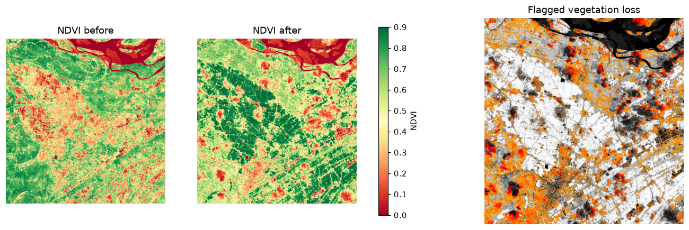

# aerial-change-intelligence

Change detection on before/after aerial and satellite imagery, with per-pixel confidence, area measurement in hectares, a Sentinel-2 vegetation-loss track for the Godavari delta (India), and a grounded LLM report whose numbers are checked automatically. Uses public data only.



## Features

- **Building change detection**: a Siamese U-Net produces a per-pixel change probability and a binary mask for an image pair.
- **Calibrated confidence**: expected calibration error (ECE) is reported alongside precision, recall, F1, and IoU.
- **Area measurement**: masks are converted to polygons with GeoPandas and measured in m² and hectares in a metric CRS.
- **Crop track, two-date**: flags NDVI drops between two Sentinel-2 dates, with cloud masking and a cloud buffer.
- **Crop track, seasonal**: compares one year's NDVI with each pixel's own 2021–24 normal for the same seasonal window.
- **Grounded report**: retrieval over agriculture guides plus Gemini, constrained to numbers from the project's own JSON results.
- **Report validation**: every number and date in the report is checked against the facts it was given; unsupported claims are flagged for review.

## Architecture

```
LEVIR-CD pair ──► Siamese U-Net ──► probability map ──► mask ──► polygons ──► area (ha)
                  (shared ResNet18                                  (GeoPandas)
                   encoder + decoder)

Sentinel-2 L2A ──► cloud mask + offset fix ──► NDVI ──► two-date drop / seasonal anomaly ──► polygons ──► area (ha)
(Planetary Computer)

JSON results ─┐
              ├─► Gemini report ──► validate.py ──► review.md
Guide PDFs ───┘   (RAG: gemini-embedding-001, NumPy cosine retrieval)
```

| Component | Role |
|---|---|
| PyTorch (`mps`), torchvision | Model training on Apple Silicon; ImageNet-pretrained ResNet18 encoder |
| GeoPandas, Shapely, rasterio, pyproj | Mask vectorization, reprojection, and area calculation |
| pystac-client, planetary-computer | Anonymous access to Sentinel-2 L2A via Microsoft Planetary Computer |
| google-genai, pypdf | Embeddings (`gemini-embedding-001`), report generation (`gemini-3.8-flash`), and PDF text extraction |
| NumPy, Pillow, matplotlib | Array processing, image I/O, figures |
| pytest | 34 tests; LLM and network calls are replaced with fakes |

## Results

### Building change detection

LEVIR-CD test split, 128 unseen 1024×1024 image pairs, threshold 0.5 ([docs/test_metrics.json](docs/test_metrics.json)):

| Precision | Recall | F1 | IoU | ECE |
|---|---|---|---|---|
| 0.908 | 0.889 | 0.898 | 0.815 | 0.007 |

Example (`test_10`): 101 changed regions, 2.75 ha total, mean confidence 0.97. LEVIR-CD has no georeferencing, so areas assume 0.5 m per pixel on a local grid.

### Crop track, Godavari delta (Sentinel-2 tile 44QPD)

| Track | Comparison | Flagged area | Notes |
|---|---|---|---|
| Two-date | 2024-12-30 vs 2025-03-15, NDVI drop ≥ 0.15 | 4,925 ha in 3,356 regions | 68% of pixels usable after cloud masking |
| Seasonal | 2025 vs 2021–24 per-pixel normal, Feb 1 – Mar 10 window | 3,005 ha in 5,997 regions | 14.6% of 22,459 ha comparable area |

A seasonal pixel is flagged when its NDVI is more than 2σ below its own normal (with a 0.05 minimum swing) and has dropped by at least 0.1. Pixels within 50 m of masked clouds are excluded.

Neither crop track has ground truth; see [Limitations](#limitations-and-future-work).

## Quickstart

```bash
conda create -n aerial-change-intelligence python=3.11 -y
conda activate aerial-change-intelligence
pip install -r requirements.txt
cp .env.example .env    # add GEMINI_API_KEY (only needed for the report)
```

Download LEVIR-CD (about 2.4 GB, the public Hugging Face mirror used by TorchGeo) so that `data/raw/levir-cd/` contains `A/`, `B/`, and `label/`:

```bash
mkdir -p data/raw/levir-cd && cd data/raw
B=https://huggingface.co/datasets/satellite-image-deep-learning/LEVIR-CD/resolve/6a6bb0a5b389403d81c05e33bf08bc0b9e5f13a6
for s in train val test; do curl -L -o $s.zip $B/$s.zip; unzip -q $s.zip -d levir-cd; done
cd ../..
```

All commands run from the project root:

```bash
export PYTHONPATH=src

# Building change
python -m aci.buildings.train --epochs 30  # about 15 minutes on an M4 Pro
python -m aci.buildings.analyze data/raw/levir-cd/A/test_10.png data/raw/levir-cd/B/test_10.png

# Crop track
python -m aci.farms.sentinel               # Godavari delta, Dec 2024 vs Mar 2025
python -m aci.farms.crop_stress && python -m aci.farms.viz
python -m aci.farms.seasonal --fetch       # 2021-2025, Feb 1 - Mar 10

# Report (requires GEMINI_API_KEY and guide PDFs in data/docs/)
python -m aci.report.rag                   # build the embedding index
python -m aci.report.report
python -m aci.report.validate              # add --strict to fail on unverified numbers
```

Outputs are written to `outputs/` (GeoJSON polygons, JSON summaries, overlay images, `report/report.md`, `report/review.md`). The guide PDFs used for retrieval (ICAR-CRIDA East Godavari contingency plan, PhilRice rice disorders field guide, FAO *Save and Grow*) are not redistributed.

## Sample report

[`docs/sample_report.md`](docs/sample_report.md) is a real report from the full pipeline, generated on 2026-10-25 by **gemini-3.5-flash** (`python -m aci.report.report --model gemini-3.5-flash`, because the default `gemini-3.8-flash` was returning 503 "high demand" errors at the time). [`docs/sample_review.md`](docs/sample_review.md) is the validator's output for it: 40 numbers and dates verified against the facts, 0 mismatched, 2 unsupported, and 11 of 33 sentences flagged for human review.

## Running tests

```bash
PYTHONPATH=src pytest
```

Tests cover metrics, the model, data loading, polygon/area conversion, NDVI rules, the seasonal check, retrieval, report assembly, and validation. They use fake embedding and generation functions and need no network access or API key.

## Project structure

```
├── .env.example             Gemini API key placeholder
├── requirements.txt
├── docs/
│   ├── godavari_ndvi.png    Two-date crop-track figure
│   ├── sample_report.md     Report generated by the full Gemini pipeline
│   ├── sample_review.md     Validator output for the sample report
│   └── test_metrics.json    LEVIR-CD test-set metrics
├── src/aci/
│   ├── buildings/           Track A: building change on LEVIR-CD
│   │   ├── data.py          LEVIR-CD loader; random crops, flips, and before/after swaps
│   │   ├── model.py         Siamese U-Net (shared ResNet18 encoder, U-Net decoder)
│   │   ├── metrics.py       Precision, recall, F1, IoU, ECE
│   │   ├── train.py         Training loop; saves checkpoints/best.pt and outputs/metrics.json
│   │   ├── predict.py       Image pair to probability map, mask, and mean confidence
│   │   └── analyze.py       Prediction, polygons, area, and overlay in one command
│   ├── farms/               Track B: Sentinel-2 crop track
│   │   ├── sentinel.py      Fetches cloud-filtered Sentinel-2 crops for two dates
│   │   ├── ndvi.py          NDVI and the vegetation-loss rule
│   │   ├── crop_stress.py   Two-date NDVI drop to loss polygons and hectares
│   │   ├── seasonal.py      Per-pixel multi-year NDVI normal and anomaly detection
│   │   └── viz.py           Crop-track figure
│   ├── report/              Track C: grounded report and fact-check
│   │   ├── rag.py           PDF chunking, Gemini embeddings, cosine retrieval
│   │   ├── report.py        Grounded Gemini report from JSON facts and retrieved passages
│   │   └── validate.py      Checks report numbers and dates against facts; flags claims
│   └── common/              Shared by more than one track
│       ├── geo.py           Mask to polygons to area (m², ha)
│       └── device.py        Selects the Apple GPU (mps) when available
├── tests/                   pytest suite
├── data/                    Datasets, Sentinel-2 crops, guide PDFs, index (not tracked)
└── outputs/, checkpoints/   Generated results and model weights (not tracked)
```

## Design decisions

- **Siamese encoder.** One set of weights encodes both images, so feature differences reflect image changes rather than encoder differences.
- **BCE + Dice loss.** Changed pixels are a small minority (5.1% on average, 3.7% median, in the LEVIR-CD test labels). Dice loss counteracts the imbalance, and evaluation uses F1 and IoU rather than accuracy.
- **Full-resolution evaluation.** Training uses random 256×256 crops; evaluation runs on full 1024×1024 images.
- **Areas in a metric CRS.** Geometries are reprojected to UTM before measuring, since degrees are not a unit of area.
- **Sentinel-2 offset handling.** The +1000 reflectance offset is removed only for scenes with processing baseline 04.00 or later, so scenes from different years are comparable.
- **Same-season, per-pixel baseline.** The seasonal track uses the same window and tile every year and compares each pixel with its own normal, which separates anomalies from normal crop-calendar changes.
- **LLM numbers are never trusted.** The model may only copy numbers from the supplied facts, advice must cite a retrieved passage, and the sources list is written by code. `validate.py` labels each number as verified, sourced, mismatch, or unsupported, and flags uncited causal claims and overclaiming language.
- **No vector database.** Retrieval is NumPy cosine similarity over a few hundred chunks.

## Limitations and future work

- **LEVIR-CD has no coordinates.** Area figures are real-scale but not located on a map.
- **The crop tracks detect vegetation loss, not confirmed crop stress.** In the dry season, an NDVI drop often reflects harvest, fallow fields, or aquaculture ponds rather than disease or drought. Their confidence values are scaled NDVI drops, not model probabilities, and there is no field ground truth.
- **Cloud masking** relies on Sentinel-2 scene classification, which can miss thin cloud and haze.
- **The validator checks numbers and words, not meaning.** It recognises only single citations like `[S1]`, so a list such as `[S1, S8, S9]` counts as uncited; it flags "confirmed" even in "not confirmed"; and it reads parts of a date window like `02-01..03-10` as separate numbers. All three appeared in the sample review.
- **Polygonization** is slow for masks with tens of thousands of small regions; labeling regions once with `scipy.ndimage.label` would fix this.
- `seasonal.py` loads every `.npz` file in its data folder, so stale files from earlier runs can enter the baseline.
- Planned: xBD building damage with real coordinates, and a dashboard.
